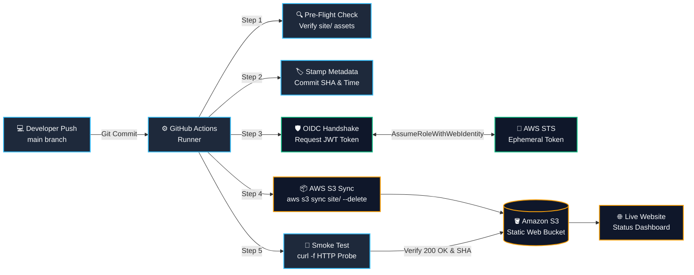

# CloudDeploy Lite 🚀
### Beginner-Friendly DevOps CI/CD Pipeline to AWS S3 via GitHub Actions & IAM OIDC

CloudDeploy Lite is an automated, production-grade DevOps starter project. It hosts a responsive, static deployment status dashboard on **Amazon S3** and synchronizes it automatically using **GitHub Actions**.

Authentication is handled securely using **AWS IAM OpenID Connect (OIDC)** token federation—eliminating the need for long-lived AWS access keys (`AWS_ACCESS_KEY_ID` and `AWS_SECRET_ACCESS_KEY`).

---

## 📌 Architecture Overview



### Key Engineering Features
1. **Zero Long-Lived Secrets:** Uses AWS IAM OIDC federated authentication. Temporary STS credentials expire automatically after 1 hour.
2. **Pure Web Technologies:** Built strictly with **HTML5, CSS3, and vanilla JavaScript**. No React, Node.js, Docker, Kubernetes, or backend dependencies.
3. **Fail-Fast Pre-Flight Validation:** Inspects and validates file existence and sizes before initiating any cloud operations.
4. **Deterministic S3 Synchronization:** Runs `aws s3 sync site/ s3://<bucket> --delete --no-progress` to ensure atomic updates and prune obsolete build assets.
5. **Automated Post-Deployment Smoke Tests:** Performs health checks using `curl` against the deployed website and fails the build if the endpoint does not return `HTTP 200`.

---

## 📁 Repository Structure

```text
CloudDeploy Lite/
├── .github/
│   └── workflows/
│       └── deploy.yml        # Automated CI/CD pipeline definition
├── site/
│   ├── index.html            # Responsive deployment status dashboard UI
│   ├── styles.css            # Modern dark-mode styling with glassmorphism
│   ├── app.js                # Vanilla JS: dynamic metadata, terminal prober, inspector
│   └── version.json          # Deployment metadata (updated dynamically by pipeline)
└── README.md                 # Complete setup, architectural, and operational documentation
```

---

## 📋 Prerequisites

Before deploying CloudDeploy Lite, ensure you have:
1. An **AWS Account** with administrative permissions to manage S3 and IAM.
2. A **GitHub Account** and a repository containing this codebase.
3. **Git CLI** installed locally to commit and push changes.

---

## 🛠️ AWS Setup (Step-by-Step)

Follow these manual steps in your AWS Console before running the GitHub Actions deployment workflow.

### Step 1: Create and Configure the Amazon S3 Bucket

1. Open the **Amazon S3 Console** at [https://console.aws.amazon.com/s3/](https://console.aws.amazon.com/s3/).
2. Click **Create bucket**.
3. **Bucket name:** Choose a globally unique name (e.g., `clouddeploy-lite-yourname-prod`).
4. **AWS Region:** Select your preferred region (e.g., `us-east-1`).
5. **Object Ownership:** Keep **ACLs disabled (recommended)**.
6. **Block Public Access settings for this bucket:**
   - Uncheck **Block *all* public access**.
   - Acknowledge the warning checkbox: *"I acknowledge that the current settings might result in this bucket and the objects within it becoming public."*
   *(Public read access is required for static website hosting).*
7. Click **Create bucket**.

#### Enable Static Website Hosting
1. Click your newly created bucket name from the list.
2. Go to the **Properties** tab.
3. Scroll down to the **Static website hosting** card (at the very bottom) and click **Edit**.
4. Select **Enable**.
5. Set **Hosting type** to: `Host a static website`.
6. Under **Index document**, enter: `index.html`.
7. Under **Error document**, enter: `index.html`.
8. Click **Save changes**.
9. Note the **Bucket website endpoint** URL displayed at the bottom of the card (e.g., `http://clouddeploy-lite-yourname-prod.s3-website-us-east-1.amazonaws.com`).

#### Configure S3 Public Read Bucket Policy
1. Select the **Permissions** tab of your bucket.
2. Under **Bucket policy**, click **Edit**.
3. Paste the following JSON policy (replace `YOUR_BUCKET_NAME` with your actual bucket name):

```json
{
  "Version": "2012-10-17",
  "Statement": [
    {
      "Sid": "PublicReadGetObject",
      "Effect": "Allow",
      "Principal": "*",
      "Action": "s3:GetObject",
      "Resource": "arn:aws:s3:::YOUR_BUCKET_NAME/*"
    }
  ]
}
```
4. Click **Save changes**.

---

### Step 2: Configure AWS IAM Identity Provider (OIDC)

GitHub Actions authenticates to AWS using OpenID Connect (OIDC). This requires an IAM Identity Provider in AWS:

1. Open the **AWS IAM Console** at [https://console.aws.amazon.com/iam/](https://console.aws.amazon.com/iam/).
2. In the left navigation, click **Identity providers**, then click **Add provider**.
3. Select **OpenID Connect**.
4. Set **Provider URL** to:
   ```text
   https://token.actions.githubusercontent.com
   ```
5. Click **Get thumbprint**.
6. Set **Audience** to:
   ```text
   sts.amazonaws.com
   ```
7. Click **Add provider**.

> **Note:** If an Identity Provider for `token.actions.githubusercontent.com` already exists in your AWS account, you can skip adding it again and proceed directly to Step 3.

---

### Step 3: Create the IAM Role for GitHub Actions

Create an IAM Role that GitHub Actions assumes during workflow execution.

1. In the IAM Console, navigate to **Roles** -> **Create role**.
2. Under **Trusted entity type**, select **Custom trust policy**.
3. Paste the following Trust Policy JSON, replacing:
   - `YOUR_AWS_ACCOUNT_ID` with your 12-digit AWS Account ID.
   - `YOUR_GITHUB_ORG_OR_USER` with your GitHub username or organization name.
   - `YOUR_REPO_NAME` with your repository name.

```json
{
  "Version": "2012-10-17",
  "Statement": [
    {
      "Sid": "GitHubActionsOIDCAuth",
      "Effect": "Allow",
      "Principal": {
        "Federated": "arn:aws:iam::YOUR_AWS_ACCOUNT_ID:oidc-provider/token.actions.githubusercontent.com"
      },
      "Action": "sts:AssumeRoleWithWebIdentity",
      "Condition": {
        "StringEquals": {
          "token.actions.githubusercontent.com:aud": "sts.amazonaws.com"
        },
        "StringLike": {
          "token.actions.githubusercontent.com:sub": "repo:YOUR_GITHUB_ORG_OR_USER/YOUR_REPO_NAME:*"
        }
      }
    }
  ]
}
```
4. Click **Next**.

#### Add Least-Privilege S3 Permissions Policy
1. On the **Add permissions** screen, click **Create policy** (opens in a new tab).
2. Select the **JSON** tab and paste the following least-privilege policy (replace `YOUR_BUCKET_NAME` with your actual bucket name):

```json
{
  "Version": "2012-10-17",
  "Statement": [
    {
      "Sid": "S3SyncBucketPermissions",
      "Effect": "Allow",
      "Action": [
        "s3:ListBucket",
        "s3:GetBucketLocation"
      ],
      "Resource": "arn:aws:s3:::YOUR_BUCKET_NAME"
    },
    {
      "Sid": "S3SyncObjectPermissions",
      "Effect": "Allow",
      "Action": [
        "s3:PutObject",
        "s3:GetObject",
        "s3:DeleteObject"
      ],
      "Resource": "arn:aws:s3:::YOUR_BUCKET_NAME/*"
    }
  ]
}
```
3. Click **Next**.
4. Policy name: `CloudDeployLite-S3SyncPolicy`.
5. Click **Create policy**.
6. Switch back to the Role creation browser tab, click the **Refresh** icon, search for `CloudDeployLite-S3SyncPolicy`, and select its checkbox.
7. Click **Next**.
8. Set **Role name** to: `GitHubActions-CloudDeployLite-Role`.
9. Click **Create role**.
10. Click on the newly created role and copy its **ARN** (e.g., `arn:aws:iam::123456789012:role/GitHubActions-CloudDeployLite-Role`).

---

## ⚙️ GitHub Repository Configuration

Configure your repository variables in GitHub. **Do not store these as secrets** because they are non-sensitive identifiers and repository variables make pipelines easier to inspect and maintain.

1. In your GitHub repository, navigate to:
   **Settings** ➔ **Secrets and variables** ➔ **Actions** ➔ **Variables** tab.
2. Click **New repository variable** for each of the following:

| Variable Name | Required | Example Value | Description |
|---|---|---|---|
| `AWS_REGION` | **Yes** | `us-east-1` | Target AWS Region where your S3 bucket resides |
| `AWS_S3_BUCKET` | **Yes** | `clouddeploy-lite-yourname-prod` | Name of the target S3 bucket |
| `AWS_ROLE_ARN` | **Yes** | `arn:aws:iam::123456789012:role/GitHubActions-CloudDeployLite-Role` | Full ARN of the IAM OIDC Role |
| `WEBSITE_URL` | Optional | `http://clouddeploy-lite-yourname-prod.s3-website-us-east-1.amazonaws.com` | Override for custom domain or S3 endpoint |

---

## 🚀 Deployment Process

### Automatic Deployment
Pushing code to the `main` branch triggers the deployment pipeline automatically:

```bash
git add .
git commit -m "feat: enhance deployment dashboard"
git push origin main
```

### Manual Trigger (On-Demand)
You can trigger the pipeline manually at any time without committing code:
1. Navigate to the **Actions** tab in your GitHub repository.
2. Under **Workflows** in the left sidebar, select **Deploy CloudDeploy Lite to AWS S3**.
3. Click the **Run workflow** dropdown on the right.
4. Select the `main` branch and click **Run workflow**.

---

## 🔬 How the CI/CD Pipeline Works

The workflow defined in [`.github/workflows/deploy.yml`](file:///.github/workflows/deploy.yml) runs through seven sequential phases:

```text
[1] Checkout Repository
    └── Pulls the latest commit from branch main.

[2] Validate Website Files
    └── Asserts that site/index.html, styles.css, app.js, and version.json
        exist and are non-empty. Fails immediately if any asset is missing.

[3] Check Required Repository Variables
    └── Verifies AWS_REGION, AWS_S3_BUCKET, and AWS_ROLE_ARN are set.

[4] Generate Deployment Metadata
    └── Dynamically stamps site/version.json with commit SHA, short SHA,
        UTC timestamp, build run number, and target AWS region.

[5] Authenticate via AWS OIDC
    └── Exchanges GitHub Actions OIDC token for temporary AWS STS credentials
        via aws-actions/configure-aws-credentials@v4.

[6] Deploy to S3
    └── Synchronizes the site/ directory using:
        aws s3 sync site/ "s3://${{ vars.AWS_S3_BUCKET }}" --delete --no-progress

[7] HTTP Smoke Test
    └── Probes the live website endpoint using curl.
    └── Validates HTTP 200 OK and asserts that version.json contains
        the current Git commit SHA.
```

---

## 🧪 Local Development & Preview

You can run and test the dashboard locally using Python's built-in HTTP server:

```bash
# From the project root directory
python3 -m http.server 8080 --directory site
```

Open [http://localhost:8080](http://localhost:8080) in your web browser.

### Features of the Local Dashboard
- **Interactive Pipeline Inspector:** Click on any of the 5 pipeline stages to inspect the underlying automation code and configuration.
- **Built-in Smoke Test Prober:** Click **Run Smoke Test** in the navbar or **Execute Probe** in the terminal widget to run a live probe against `version.json`, displaying real-time latency (RTT), response status, and schema validation.
- **Copy Utilities:** Click the commit SHA or **Copy JSON** buttons for quick inspection.

---

## 🔧 Troubleshooting Guide

| Issue / Error | Potential Cause | Resolution |
|---|---|---|
| `Not authorized to perform sts:AssumeRoleWithWebIdentity` | OIDC Trust Policy repository or audience mismatch | Ensure the `sub` claim in your IAM Role Trust Policy exactly matches `repo:YOUR_ORG/YOUR_REPO:*` and that `aud` is set to `sts.amazonaws.com`. |
| `HTTP 403 Forbidden` on S3 Website URL | Public access is blocked or Bucket Policy is missing | In the S3 bucket's **Permissions** tab, verify **Block Public Access** is unchecked and the bucket policy grants `s3:GetObject` to `Principal: "*"`. |
| `HTTP 404 Not Found` on S3 Website URL | Static Website Hosting is disabled | Go to S3 Bucket ➔ **Properties** ➔ **Static website hosting** and confirm it is **Enabled** with `index.html` as the index document. |
| `Required file missing: site/...` | Incomplete codebase bundle | Ensure `site/index.html`, `site/styles.css`, `site/app.js`, and `site/version.json` are committed to the `main` branch. |
| Smoke Test times out or fails with connection error | Regional endpoint mismatch | S3 static website hosting URLs vary by region. If using `us-east-1`, set `WEBSITE_URL` in your GitHub repository variables to the exact endpoint shown in the S3 console. |

---

## ⚠️ Manual AWS Setup Checklist

Before triggering your very first workflow run, make sure you have completed these steps:

- [ ] S3 bucket created with a globally unique name.
- [ ] S3 Block Public Access disabled for the website bucket.
- [ ] S3 Static Website Hosting enabled with `index.html`.
- [ ] S3 Bucket Policy added granting public `s3:GetObject` permissions.
- [ ] IAM OIDC Identity Provider created for `token.actions.githubusercontent.com`.
- [ ] IAM Role created with Trust Policy scoped to your GitHub repo.
- [ ] IAM Permissions Policy attached allowing `s3:ListBucket`, `s3:PutObject`, `s3:GetObject`, and `s3:DeleteObject`.
- [ ] GitHub Repository Variables configured (`AWS_REGION`, `AWS_S3_BUCKET`, `AWS_ROLE_ARN`).

---

## 🧹 Resource Cleanup

To avoid keeping unnecessary resources in your AWS account after completing this project:

```bash
# 1. Empty and delete the S3 bucket using the AWS CLI
aws s3 rm s3://YOUR_BUCKET_NAME --recursive
aws s3api delete-bucket --bucket YOUR_BUCKET_NAME --region YOUR_REGION

# 2. Delete the IAM Role and Policy
aws iam detach-role-policy --role-name GitHubActions-CloudDeployLite-Role --policy-arn arn:aws:iam::YOUR_ACCOUNT_ID:policy/CloudDeployLite-S3SyncPolicy
aws iam delete-policy --policy-arn arn:aws:iam::YOUR_ACCOUNT_ID:policy/CloudDeployLite-S3SyncPolicy
aws iam delete-role --role-name GitHubActions-CloudDeployLite-Role
```

Or delete them directly through the AWS S3 and IAM Web Consoles.

---

## 📄 License
MIT License. Open-source for educational and DevOps training purposes.
